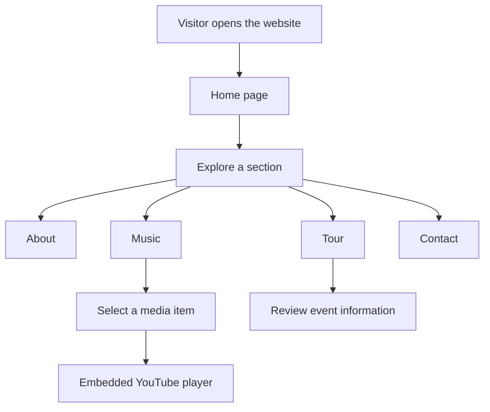

# RUANG BARASUARA

**A fan-made digital space for music, stories, and live-show discovery.**

A static, multi-page web experience built around the music and visual identity associated with Barasuara.

> **Project disclosure**  
> This is an independent fan-made website and portfolio project. It is not an official Barasuara website, is not endorsed by the band or its management, and does not represent an official ticketing channel.

---

## Overview

Ruang Barasuara explores how a focused music website can bring editorial content, album discovery, artist information, and tour-style listings into one cohesive experience. The repository is implemented as a lightweight front-end project without a dedicated application server or database.

## Experience

- **Home** — hero section, featured content, and editorial-style highlights.
- **About** — artist and project information.
- **Music** — album-oriented content and embedded video playback.
- **Tour** — event-style listings and calls to action.
- **Contact** — a dedicated contact page.
- **Interaction layer** — responsive navigation, reveal-on-scroll effects, and browser-based media controls.
- **Adaptive presentation** — selected visual effects are reduced on constrained connections or lower-performance environments.

The content is maintained in the source files. Dates, event details, links, and media references should be checked before any public presentation.

## How the experience flows

The project is a static, page-based fan experience. Visitors move between editorial and media sections, while playback is handled by the browser through an embedded media player.

## Technology

| Layer | Implementation |
| --- | --- |
| Markup | HTML5 |
| Styling | CSS3 |
| Interactions | Vanilla JavaScript |
| Media | YouTube embedded player and browser audio APIs |
| Icons | Font Awesome CDN |
| Delivery | Static web hosting |

## Run locally

No package installation or build step is required.

    git clone https://github.com/gusti111/Ruang-Barasuara.git
    cd Ruang-Barasuara
    python -m http.server 8000

Open http://localhost:8000 in a browser.

You can also open index.html directly, although a local server provides a more reliable environment for browser features and relative paths.

## Repository structure

    Ruang-Barasuara/
    ├── index.html
    ├── about.html
    ├── music.html
    ├── tour.html
    ├── contact.html
    ├── style/
    │   └── style.css
    ├── lib/
    │   └── script.js
    └── images/
        └── project media and artwork

## Development notes

- Keep media references and image paths relative to the repository.
- Use official sources when verifying artist information, event dates, or ticket availability.
- Do not present static event cards or external links as a functioning ticket purchase system.
- Respect the rights and platform terms for all images, recordings, and embedded media.

## Project status

A static front-end project. No account system, content-management backend, payment processing, or live ticket inventory is included in this repository.

## Author

**Gusty Faqikh** · [GitHub](https://github.com/gusti111)